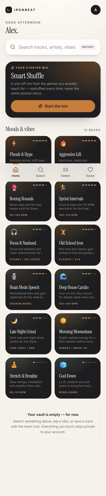
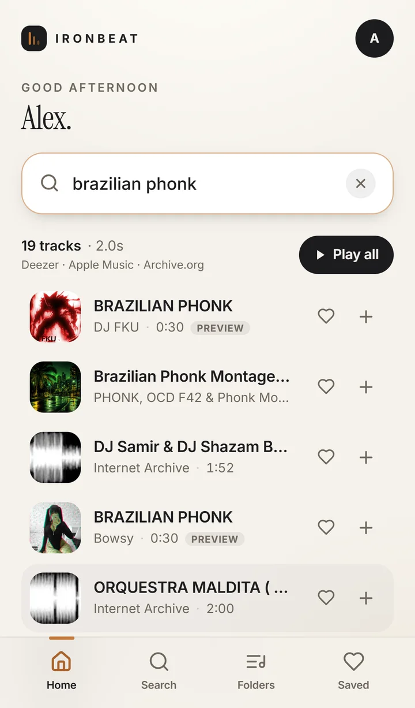

# IronBeat

A private, mobile-first workout music PWA. Instant multi-source search, curated mood decks, a persistent mini-player with lock-screen controls, and per-user playlists — built for the ninety seconds between heavy sets.

**Stack:** Next.js 15 (App Router) · TypeScript · Tailwind CSS · Drizzle ORM · Neon PostgreSQL · HTML5 Audio

<p align="center">
  
  
  
</p>

---

## What it does

| Area | Behaviour |
| --- | --- |
| **Auth** | Email + password, bcrypt (cost 11), opaque session tokens hashed in Postgres. Instant access — no approval queue. |
| **Isolation** | Every playlist, track, favourite and search row is scoped by `user_id`. No cross-tenant read path exists. |
| **Search** | One query fans out to YouTube, Audius and the Internet Archive, then interleaves and de-duplicates the results — YouTube first. |
| **Playback** | Two backends — HTML5 for Audius/Archive, YouTube's official IFrame player for YouTube — behind one state machine. |
| **Continuity** | Selecting any result queues the whole result list, so playback keeps rolling track after track. |
| **Chips** | Successful searches become one-tap quick-launch chips. |
| **Moods** | 12 curated training vibes that expand into live playlists at tap time. |
| **Smart Shuffle** | Builds a one-off mix from your most-searched genres and most-played artists. |
| **PWA** | Web App Manifest, iOS standalone meta, service worker, offline fallback, Media Session for lock screen / AirPods. |

---

## Architecture

```
┌──────────────────────────────────────────────────────────────┐
│  Browser (PWA)                                               │
│                                                              │
│  app/*  ── React Server Components ──►  lib/data.ts  ──┐     │
│    │                                                   │     │
│    └── client islands                                  │     │
│         ├── SearchExperience  ──► /api/search          │     │
│         ├── MoodDeck          ──► /api/moods/[slug]    │     │
│         ├── MiniPlayer / FullPlayer                    │     │
│         │      └── AudioEngine (useSyncExternalStore)  │     │
│         │            ├── HTMLAudioElement (in DOM)     │     │
│         │            ├── YouTube IFrame adapter        │     │
│         │            ├── Audio Session API (iOS)       │     │
│         │            └── Media Session API             │     │
│         └── FavoritesProvider / ToastProvider          │     │
└────────────────────────────────────────────────────────┼─────┘
                                                         │
                       ┌─────────────────────────────────▼──────┐
                       │  Route handlers (app/api/**)           │
                       │  auth · search · playlists · favourites │
                       │  plays · moods · smart-shuffle          │
                       └───────────────┬────────────────────────┘
                                       │
              ┌────────────────────────┼─────────────────────────┐
              │                        │                         │
      ┌───────▼────────┐      ┌────────▼────────┐      ┌─────────▼────────┐
      │ lib/audio/     │      │ lib/data.ts     │      │ lib/auth.ts      │
      │ search.ts      │      │ (Drizzle)       │      │ sessions+bcrypt  │
      │ providers/*    │      └────────┬────────┘      └─────────┬────────┘
      └───────┬────────┘               │                         │
              │                        │                         │
   ┌──────────▼──────────┐   ┌─────────▼─────────┐     ┌─────────▼────────┐
   │ YouTube · Audius    │   │ Neon (HTTP)  or   │     │ sessions table   │
   │ Archive.org · YT    │   │ node-postgres     │     │ (sha256 tokens)  │
   └─────────────────────┘   └───────────────────┘     └──────────────────┘
```

### Three decisions worth knowing

**1. The player is a framework-agnostic engine, not a React context.**
`lib/audio/engine.ts` owns all transport state and both playback backends. React subscribes with `useSyncExternalStore`, so a `timeupdate` event re-renders only the components reading the clock — not the page tree. Audio Session declaration, Media Session handlers, queue persistence and autoplay-unlock all live in one place instead of being scattered across effects.

**2. Search is a server-side fan-out with per-source status.**
Providers are called in parallel with individual timeouts. A dead source degrades to a reported status rather than failing the request, and the UI shows exactly which catalogues answered. Results are round-robin interleaved so no single provider owns the top of the list, then de-duplicated on normalised `title + artist`.

**3. One-tap playback survives an async search.**
iOS only permits programmatic audio after a real tap. Chips and mood cards need a network round-trip before they know what to play, so `engine.unlock()` primes the audio element synchronously inside the tap with 50 ms of silence. When results land, `play()` is already trusted.

---

## Project structure

```
app/
  api/
    account/                 DELETE — erase account (cascade)
    auth/{login,logout,me,register}/
    favorites/               GET list · POST toggle
    health/                  GET deployment diagnostics
    history/plays/           GET recently played · POST log a play
    mix/smart-shuffle/       GET behavioural mix
    moods/[slug]/            GET expanded mood playlist
    playlists/               GET list · POST create
    playlists/[id]/          GET · PATCH · DELETE
    playlists/[id]/tracks/   POST add · DELETE remove
    playlists/[id]/tracks/move/  POST reorder
    search/                  GET unified search
    search/history/          GET chips · DELETE clear
  (auth pages, home, search, playlists, library, account, offline)
  layout.tsx  globals.css  manifest.ts  error.tsx  not-found.tsx
components/
  player/       MiniPlayer · FullPlayer · TrackRow · AddToPlaylistSheet
  search/       SearchExperience · SearchPageView · useTrackSearch
  home/         HomeView · MoodDeck · SmartShuffleCard · RecentRail
  playlists/    PlaylistsView · PlaylistDetailView · PlaylistTrackRow
  providers/    PlayerProvider · FavoritesProvider · ToastProvider
  ui/           Button · Sheet · Artwork · Equalizer
db/
  schema.ts     7 tables, 14 indexes
  index.ts      driver-aware client (Neon HTTP | node-postgres)
drizzle/        0000_init.sql + journal
lib/
  audio/        engine.ts · youtube.ts · search.ts · providers/* · cache.ts
  auth.ts       bcrypt + opaque sessions
  data.ts       every query, always user-scoped
  moods.ts      the 12-mood deck definition
  validation.ts zod schemas
  api.ts        JSON helpers · CSRF check · SQLSTATE extraction
  rate-limit.ts fixed-window limiter
```

---

## Data model

| Table | Purpose | Key constraint |
| --- | --- | --- |
| `users` | Credentials + display name | unique `email` |
| `sessions` | Hashed session tokens, 30-day TTL | unique `token_hash` |
| `playlists` | User folders | index `(user_id, updated_at)` |
| `playlist_tracks` | Denormalised track snapshots + position | unique `(playlist_id, track_id)` |
| `favorite_tracks` | Saved tracks | unique `(user_id, track_id)` |
| `search_history` | Chips + taste signal | unique `(user_id, normalized)` |
| `search_cache` | Persistent cache for quota-metered upstream queries | primary key `key` |
| `track_plays` | Play log for recent + Smart Shuffle | index `(user_id, played_at)` |

Track snapshots are intentionally denormalised: a playlist keeps playing even if an upstream catalogue changes shape or delists the item.

---

## Audio sources

| Source | Key required | Playable audio | Notes |
| --- | --- | --- | --- |
| **YouTube** | `YOUTUBE_API_KEY` | Full-length, official IFrame Player | **Priority source.** Data API v3 for search, official player for playback — the only route YouTube's terms permit. |
| **Audius** | No | Full-length MP3 | Decentralised catalogue. Stream URL points at the stable API endpoint, which redirects to a freshly signed CDN URL on each request — so saved tracks never expire. |
| **Internet Archive** | No | Full-length MP3 | Two-step: search → item metadata → best MP3. |

YouTube is searched first: its results lead the list, and de-duplication keeps the YouTube copy when a track exists on several sources.

**Playback behaviour differs by source, and that difference is imposed by the platform:**

- **HTML5 tracks** (Audius, Internet Archive) keep playing through a lock, on the lock screen, and through AirPods.
- **YouTube tracks** play full-length in the official player while the app is in the foreground. iOS suspends cross-origin iframe media when the page is backgrounded, and no web API can override that — Audio Session and Media Session apply to the page's own media, not to an iframe owned by another origin.

Extracting YouTube audio streams (signature deciphering, `googlevideo` URLs, Invidious-style proxies) would technically close that gap, but it breaches YouTube's Terms of Service and circumvents technical protection measures. IronBeat does not do it.

No preview clips anywhere: Apple Music and Deezer were removed because their public APIs only return 30-second fragments.

---

## Security model

- **Passwords** — bcrypt, cost 11. Login always performs a hash comparison so response time doesn't reveal whether an account exists.
- **Sessions** — 32 random bytes, base64url in an `httpOnly` `SameSite=Lax` cookie; only the SHA-256 hash is stored. Logout deletes the row, so a stolen cookie dies with it.
- **CSRF** — SameSite=Lax plus an Origin/Host check on every mutating handler.
- **Rate limits** — fixed-window per IP and per account on auth, plus per-user caps on search, moods and mixes.
- **Isolation** — `lib/data.ts` never exposes a "get by id" query; every statement carries `user_id`.
- **Headers** — `nosniff`, `SAMEORIGIN`, strict referrer policy, and a locked-down permissions policy.

---

## Scripts

```bash
npm run dev        # local dev server
npm run build      # production build
npm run typecheck  # tsc --noEmit
npm run smoke      # end-to-end HTTP test (needs a running server)
npm run icons      # regenerate the PWA icon set
npm run db:generate / db:migrate / db:push / db:studio
```

`npm run db:migrate` runs `scripts/migrate.mjs`, which applies every pending migration and verifies the seven tables exist. The `vercel-build` script chains it before `next build`, so a deploy can never ship against an empty database.

`GET /api/health` reports database reachability, schema completeness and the active audio sources — the first thing to check after a deploy.

`scripts/smoke-test.mjs` drives a running instance through 68 assertions: registration, duplicate/weak-password handling, session lifecycle, multi-source search, playlist CRUD + reorder, cross-tenant isolation, favourites, play logging, moods, Smart Shuffle, and every page render. It creates and deletes its own accounts.

```bash
npm run build && npm start &
node scripts/smoke-test.mjs http://localhost:3000
```

---

## Documentation

- **[DEPLOYS_GUIDE.md](./DEPLOYS_GUIDE.md)** — local setup, Neon, environment variables, Vercel deployment, PWA configuration, GitHub integration, troubleshooting.
- **[USER_GUIDE.md](./USER_GUIDE.md)** — sign-up, Add to Home Screen, instant search, chips, moods, folders, lock-screen controls.
